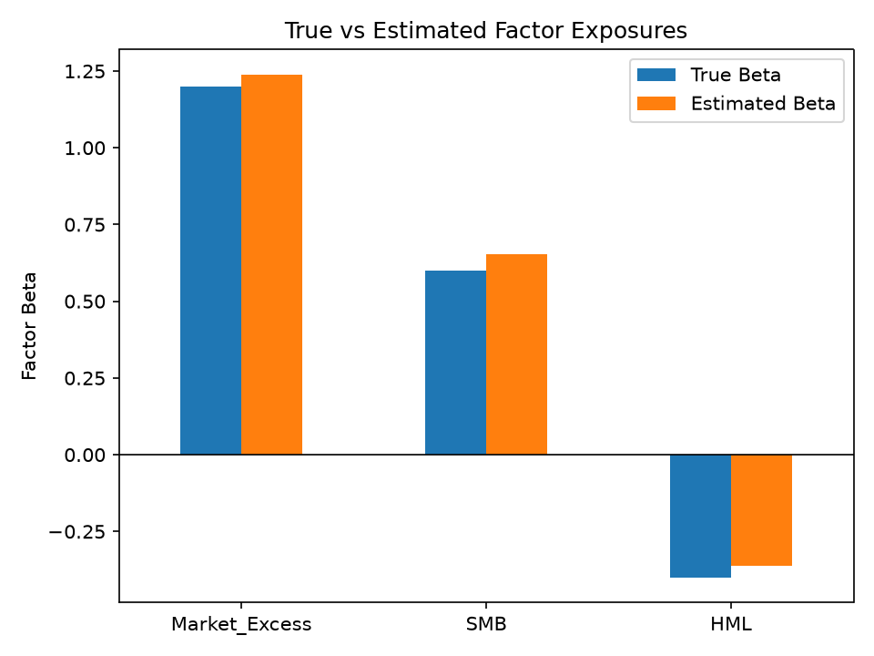

# Note 22 — APT & Factor Models

A small Python exercise fitting a Fama–French-style three-factor regression to 120 months of simulated excess returns. The purpose is to recover known factor exposures and interpret estimation uncertainty. No real security, market download or API key is involved.

## Model and method

The model is:

```text
Stock Excess Return = alpha + beta_m * Market Excess Return
                      + beta_s * SMB + beta_h * HML + error
```

- Market Excess Return: market return minus the risk-free return.
- SMB (Small Minus Big): small-cap minus large-cap portfolio return.
- HML (High Minus Low): high minus low book-to-market portfolio return.
- Alpha: the regression intercept; each beta is a conditional factor exposure, holding the other included factors fixed.

These are synthetic analogues of the factors, not downloaded Fama–French factor portfolios. APT supplies a broader factor-pricing framework; this exercise does not derive or test the no-arbitrage foundations of APT.

NumPy's generator uses seed `22`. Factors and noise are independently sampled across time and from one another under the simulation design:

| Series | Monthly mean | Monthly standard deviation |
|---|---:|---:|
| Market Excess Return | 0.5% | 4.0% |
| SMB | 0.2% | 2.5% |
| HML | 0.3% | 3.0% |
| Noise | 0.0% | 3.0% |

The data-generating equation sets monthly alpha to `0.002` and betas to `[1.2, 0.6, -0.4]`. Realised sample correlations need not be exactly zero. All returns are decimals; the stock and market series are already excess returns, so no additional risk-free subtraction is needed.

OLS jointly estimates the four coefficients by minimising the sum of squared residuals. `sm.add_constant(X)` supplies the intercept column. The report uses conventional, nonrobust standard errors, consistent with the independent homoskedastic normal error design used here.

## Run

Tested with Python 3.13.15. From this project folder on macOS/Linux:

```bash
python3.13 -m venv .venv
.venv/bin/python -m pip install -r requirements.txt
.venv/bin/python note22_practice.py
```

If the environment already exists, only the last command is needed. Choose `.venv/bin/python` as the VS Code interpreter. NumPy, pandas, statsmodels and Matplotlib versions are pinned in `requirements.txt`; transitive dependencies are not fully locked.

The script prints the data preview and OLS report, saves the outputs beside the script, and opens a chart. Close the chart to finish the interactive run. On a machine without a display, use `MPLBACKEND=Agg .venv/bin/python note22_practice.py`; the saved PNG is still produced, although `show()` may emit a non-interactive-backend warning.

## Outputs

| File | Contents |
|---|---|
| [note22_practice.py](note22_practice.py) | Simulation, OLS, comparison chart and exports |
| [simulated_data.csv](outputs/simulated_data.csv) | 120 observations and four return columns |
| [regression_summary.txt](outputs/regression_summary.txt) | Full OLS report |
| [factor_betas.png](outputs/factor_betas.png) | True versus estimated factor betas |
| [LEARNING_REVIEW.md](LEARNING_REVIEW.md) | Interpretation guide and independent exercises |

CSV rows represent successive synthetic months, not real calendar dates. Every run overwrites the three generated outputs; the report timestamp changes even when the simulated values do not. The virtual environment is excluded by `.gitignore`.

## Results

Generated and checked on 17 November 2026:

| Parameter | True value | Estimate | Standard error | t-statistic | Two-sided p-value |
|---|---:|---:|---:|---:|---:|
| Monthly alpha | 0.002000 | 0.002577 | 0.002775 | 0.929 | 0.355 |
| Market beta | 1.200000 | 1.237751 | 0.063223 | 19.578 | 1.44e-38 |
| SMB beta | 0.600000 | 0.652300 | 0.123453 | 5.284 | 6.01e-7 |
| HML beta | -0.400000 | -0.362520 | 0.086333 | -4.199 | 5.28e-5 |

R-squared is **0.77645**, with adjusted R-squared approximately **0.771**. The model accounts for about 77.6% of the sample variation in stock excess returns around their mean; this is not forecast accuracy or the percentage of returns earned from factors.

The simulated stock exhibits above-one market exposure, positive size-factor exposure and negative value-factor exposure. These are conditional return sensitivities, not direct evidence about a real company's characteristics. The estimated betas are close to their generating values, as expected under this correctly specified simulation.

Monthly alpha is approximately **0.258%**, but its p-value is **0.355** and its 95% confidence interval is approximately **[-0.292%, 0.807%]**. At the 5% level, the sample does not reject zero alpha. This neither establishes that alpha is zero nor assigns a 35.5% probability to the null hypothesis. Indeed, the generating alpha is positive, illustrating that a nonzero effect can remain statistically undetected in a finite noisy sample. Printed p-values of `0.000` are rounded, not literally zero.



The chart compares point estimates only; it does not display confidence intervals or establish statistical significance.

## Limitations and learning status

- Simulated, independent normal factors and constant exposures simplify actual financial data, which can exhibit correlated factors, changing exposures, heavy tails and serial dependence.
- The generating and fitted models match by design. Good in-sample fit here is not evidence of predictive investment performance.
- A positive estimated alpha is not proof of skill or mispricing. Statistical significance measures evidence relative to uncertainty; economic significance concerns magnitude and practical value, including costs and persistence.
- There is no real-stock valuation, out-of-sample test, trading strategy or transaction-cost analysis in this exercise.
- The implementation and exports are complete. Independent interpretation of statistical inference and the learner's 100–150-word commentary remain learning tasks; they have not been assessed as passed.

Verification covered the script run, finite 120-by-4 exported data, OLS residual orthogonality to the design matrix, the R-squared identity, and the saved report and PNG. The chart was also visually inspected.

## Reference

[statsmodels OLS documentation](https://www.statsmodels.org/stable/generated/statsmodels.regression.linear_model.OLS.html) describes the model interface and the need to include a constant explicitly.
